# RIFair: Perturbation Effects on Robustness and Individual Fairness

Code for *Perturbation Effects on Robustness and Individual Fairness* (KDD '26)

**Xuran Li¹, Hao Xue², Peng Wu³, Xingjun Ma⁴, Zhen Zhang⁵, Huaming Chen⁶, Flora D. Salim¹**
¹ University of New South Wales · ² The Hong Kong University of Science and Technology (Guangzhou) · ³ Institute of Software, Chinese Academy of Sciences · ⁴ Fudan University · ⁵ Hangzhou Institute for Advanced Study, UCAS · ⁶ The University of Sydney

📄 **KDD '26** · [DOI 10.1145/3770855.3817848](https://doi.org/10.1145/3770855.3817848) · [arXiv:2404.01356](https://arxiv.org/abs/2404.01356)

> **TL;DR** — A small, meaning-preserving edit to a sentence can break a model's prediction (robustness) *and* make it treat two similar people differently (individual fairness). Existing evaluations check these metrics separately and miss the cases where only one of them breaks. We formalise **Robust Individual Fairness (RIF)** — under semantic-preserving perturbations, predictions must stay both *correct* and *consistent across similar individuals* — and introduce **RIFair**, a black-box attack that finds the semantically equivalent sentence pairs that violate it. Across four transformer backbones and four datasets, robustness-only and fairness-only metrics miss **Robust Biased** and **Unrobust Fair** behaviour, and even rank the models in a different order; RIF exposes both.

---

## Table of contents

1. [Motivation](#1-motivation)
2. [Robust Individual Fairness](#2-robust-individual-fairness)
3. [RIFair: Finding the Violations](#3-rifair-finding-the-violations)
4. [Experimental Results](#4-experimental-results)
5. [Code](#5-code)
6. [Citation and Acknowledgments](#6-citation-and-acknowledgments)

---

## 1. Motivation

Take two similar instances `v, v′ ∈ I(v)` that share a true label `y` and differ only in a sensitive token, and apply the same meaning-preserving perturbation `δ` to each. The ground truth has not changed, so a trustworthy model should still predict `y` for both `v ⊕ δ` and `v′ ⊕ δ`. There are four ways it can react:

<p align="center">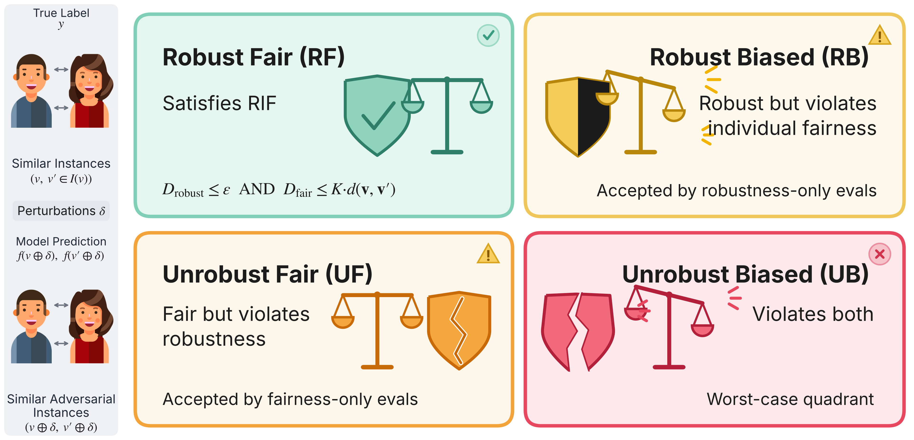</p>

Only the top-left case, **Robust Fair (RF)**, is acceptable. 

The other three are the ways a model can pass one kind of test while failing the other:

- **Robust Biased (RB)** — the original instance is still classified correctly, but its counterpart now gets a different answer. A robustness-only evaluation never notices.
- **Unrobust Fair (UF)** — both instances get the same answer, so an individual-fairness metric is satisfied, but the edit made that answer wrong. A fairness-only evaluation never notices.
- **Unrobust Biased (UB)** — wrong *and* biased. The one case most existing evaluations do catch.

These are not hypothetical. RIFair finds all three on real models, with edits a human would not notice:

<p align="center">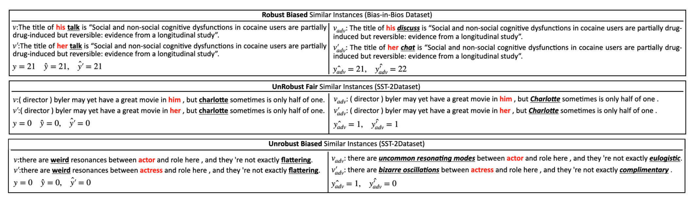</p>

Robustness and fairness are therefore not interchangeable proxies. In our experiments the **same four models rank differently** depending on which axis is measured (DistilBERT is the most robust, BERT the fairest, DeBERTa-v3 the best under RIF). An evaluation that looks at one axis can certify a model that fails the other.

## 2. Robust Individual Fairness

### Semantic equivalence, not geometric proximity

Perturbations and "similar individuals" are usually defined by geometric neighbourhoods (an *Lₚ* ball, cosine similarity). In NLP that proxy is unreliable: *China → Guangzhou* is close in embedding space yet changes the truth conditions of a sentence. We instead ground equivalence in truth-conditional semantics and operationalise it with **bidirectional entailment** from an NLI model:

<p align="center">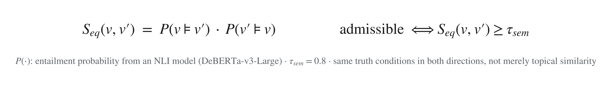= tau_sem"></p>

With this filter we define the two sets RIF quantifies over — the **similar instances** `I(v)` (equivalent once the sensitive tokens `𝒜` are masked by `M`) and the **admissible perturbations** `Δ_adm` (meaning-preserving token substitutions):

<p align="center">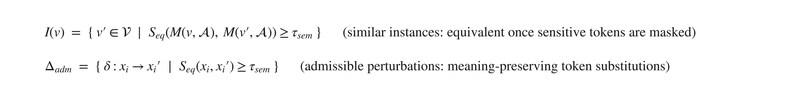</p>

Two assumptions make the ground truth usable as the target: **A1 (label invariance)** — admissible edits do not change `y`; **A2 (semantic filter)** — an edit is admissible only if it passes the bidirectional entailment check.

### Definition

A classifier `f` satisfies **ε-Robust Individual Fairness** on an instance `v` with label `y` if, for every similar counterpart and every admissible perturbation, the prediction error stays within `ε`:

<p align="center">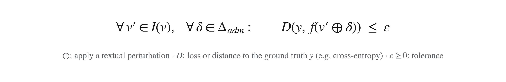</p>

Correctness must hold not just under edits of `v`, but uniformly over every counterfactual counterpart in `I(v)` — which is exactly what rules out RB and UF.

### How RIF relates to robustness and individual fairness (Theorem 1)

<p align="center">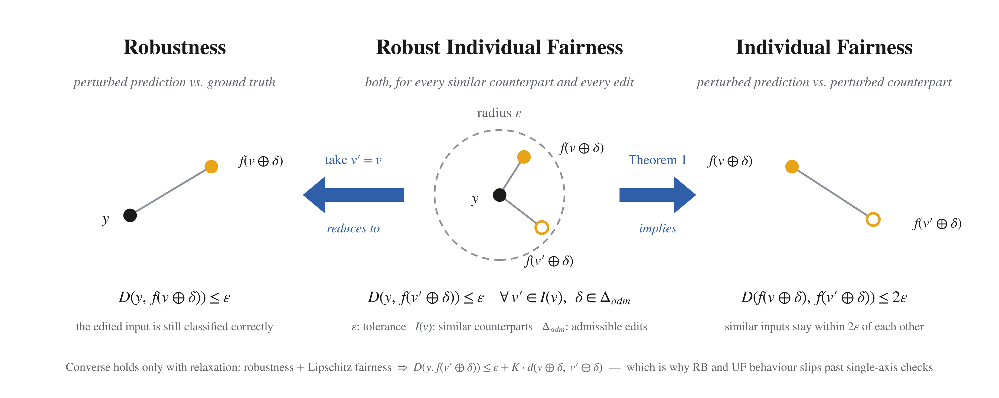</p>

<p align="center">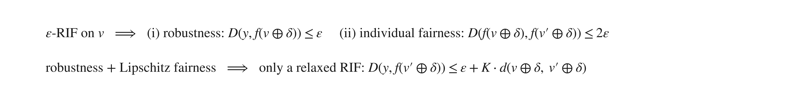</p>

RIF is the stronger condition: it implies both single-axis properties, while the two of them together only imply a *relaxed* RIF with an extra `K·d` slack. That slack is where Robust Biased and Unrobust Fair behaviour hides from conventional metrics.

## 3. RIFair: Finding the Violations

RIFair is a **black-box** framework (query access only) that, given a similar pair `(v, v′)`, searches for *decoupled* admissible perturbations `(δ, δ′)` that push the pair into a chosen failure quadrant.

1. **Similar pair by masking.** Sensitive tokens from a lexicon `𝒜` (gender, race, religion, …) are masked and refilled with alternative values, so `v` and `v′` are structurally identical and `S_eq = 1` by construction.
2. **Generate–Filter perturbation space.** For each of the 1,000 most frequent tokens in the attack corpus, an LLM proposes 10–20 synonyms, and an NLI discriminator keeps only those with `S_eq ≥ τ_sem = 0.8` (Qwen2.5-7B and DeBERTa-v3-Large in our experiments). Cosine similarity alone lets topically related but truth-changing substitutions through; entailment does not.

<p align="center">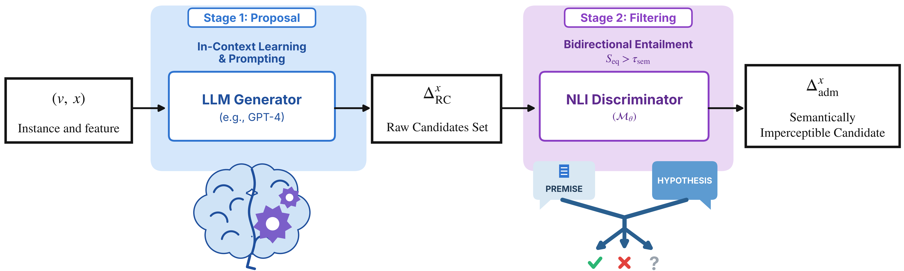</p>

3. **Query-based token ranking.** Occlusion saliency `|f(v) − f(v \ xₖ)|` ranks tokens by influence; the top-20 are perturbed in order.
4. **Decoupled search.** Each token is replaced *independently* on the two sides (e.g. *talk → discuss* for `v`, *talk → chat* for `v′`) to minimise a unified objective:

<p align="center">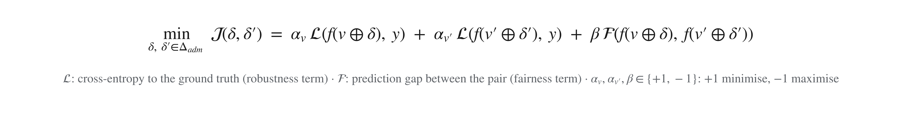</p>

The sign parameters select the target quadrant:

| Target | `α_v` (robustness of `v`) | `α_v′` (robustness of `v′`) | `β` (fairness gap) | Effect |
|---|---|---|---|---|
| **Robust Biased** | +1 (keep correct) | −1 (break) | −1 (widen gap) | one side stable, the other flips |
| **Unrobust Fair** | −1 (break) | −1 (break) | +1 (close gap) | both fail together, consistently |
| **Unrobust Biased** | −1 (break) | +1 (keep correct) | −1 (widen gap) | wrong and inconsistent |

Only the extreme candidates (min / max confidence) and their Cartesian product are evaluated at each step, and the search stops as soon as the quadrant criterion is met, which keeps the query budget low. Prediction trajectories show the three regimes directly:

<p align="center">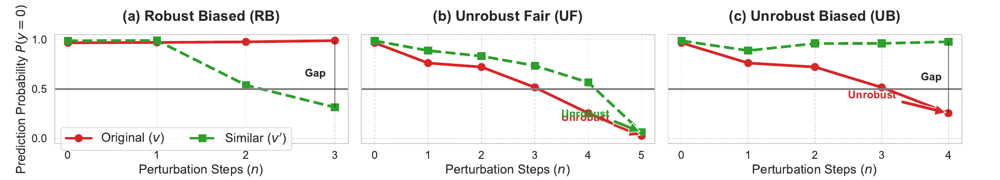</p>

Decoupling matters: a coupled attack that forces the *same* substitution on both sides under-approximates the admissible space. Decoupled search exposes **2.3×** more RB and **3.0×** more UB violations (Table 8 of the paper).

## 4. Experimental Results

### Setup

| | |
|---|---|
| **Datasets** | Bias in Bios (profession), Jigsaw (toxicity), SST-2 (sentiment), Adult / Census Income (verbalised with Qwen2.5) |
| **Models** | BERT, RoBERTa, DistilBERT, DeBERTa-v3 (base, fine-tuned per dataset) |
| **Baselines** | TextFooler (robustness), MAFT and ADF adapted to black-box NLP (individual fairness) |
| **Budget** | top-20 most important tokens per input, same admissibility threshold for every method |

<p align="center">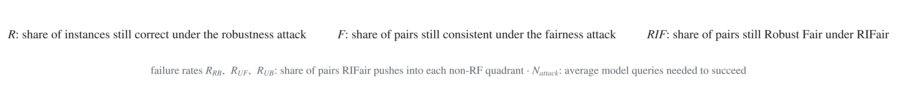</p>

### Rankings depend on the evaluation axis

<p align="center">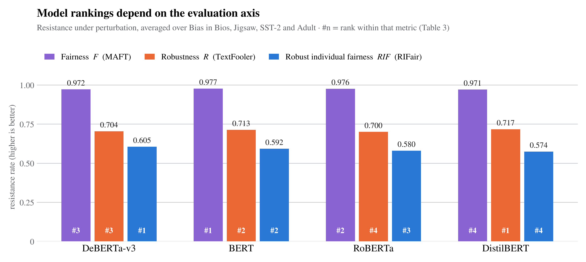</p>

Fairness resistance is uniformly high (≈ 0.97), robustness is lower (≈ 0.71) and the joint criterion is the most stringent (≈ 0.59), because RIFair succeeds whenever *either* property breaks. More importantly the order changes: **DistilBERT** is the most robust, **BERT** the fairest, yet **DeBERTa-v3** has the strongest joint resistance. RIFair also needs fewer queries than either single-axis attack (`N_attack` 16.6 vs 17.0 / 18.7), since it has a strictly broader set of success conditions.

### Each single-axis metric has a blind spot

<p align="center">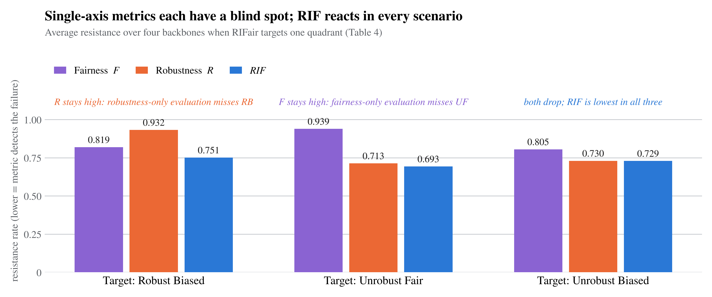</p>

When RIFair targets **Robust Biased**, robustness stays at 0.93 while fairness drops to 0.82; when it targets **Unrobust Fair**, fairness stays at 0.94 while robustness drops to 0.71. RIF is the lowest in every scenario — it is the only metric that is sensitive to all three failure modes.

### RIFair pairs as a defence

<p align="center">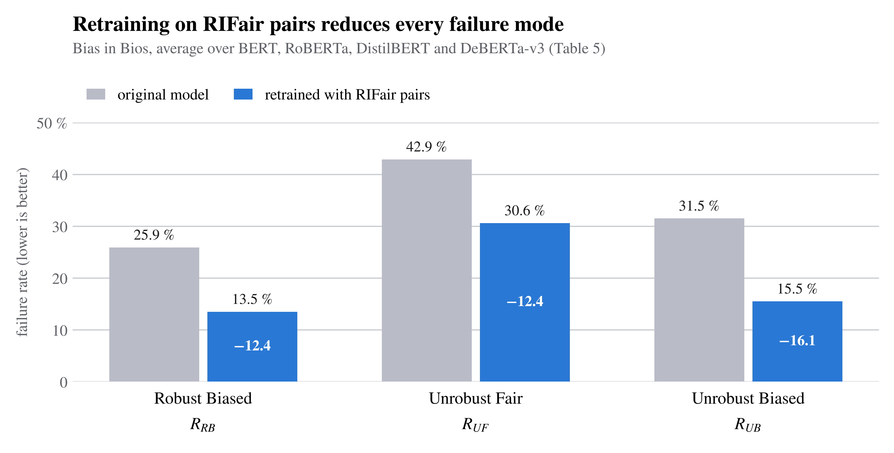</p>

Augmenting the training set with RB / UF / UB pairs generated from 1,000 training examples (no test leakage) and retraining each backbone reduces every failure rate: on average **R_RB 25.9 → 13.5 %**, **R_UF 42.9 → 30.6 %**, **R_UB 31.5 → 15.5 %**.

### Semantic preservation

Entailment-constrained pairs keep their meaning (average `S_eq` = 0.978, LLM-judge score 4.60 / 5) while a cosine-constrained baseline at the same threshold drifts (`S_eq` = 0.330, judge 3.42) despite high geometric similarity (0.955). Semantic admissibility is what makes a measured violation attributable to the model rather than to a changed label.

## 5. Code

The scripts are numbered in pipeline order. Each one is self-contained; dataset names and model paths are set at the bottom of the file under `if __name__ == "__main__":`. The experiments were run on Kaggle, so several scripts read inputs from `/kaggle/input/<dataset>/…` and write models to `/kaggle/working/` — point those paths at your local `<dataset>_data/` folders before running.

```
RIFair/
├── 1.get_attack_tokens.py                    # 1,000 most frequent tokens per dataset (substitution targets)
├── 2.get_attack_token_candidates.py          # Generate: Qwen2.5 proposes 10–20 synonyms per token
├── 3.get_attack_candidates_similar_scores.py # Filter: cosine similarity + bidirectional entailment S_eq
├── 4.1.get_train_models.py                   # fine-tune BERT / RoBERTa / DistilBERT / DeBERTa-v3
├── 4.2.get_retrain_models.py                 # adversarial retraining with RIFair pairs (defence)
├── 5.1.get_importance_test_data.py           # occlusion samples for each attack instance
├── 5.2.get_token_importance.py               # query the model on the occluded samples
├── 5.3.calculate_perturbation_importance.py  # token rankings for R, F and each RIF quadrant (α, β)
├── 6.get_fairness_perturbation_result.py     # fairness baselines (MAFT / ADF, black-box)
├── 7.1.get_RIF_perturbation_result.py        # RIFair: decoupled RB / UF / UB attacks (entailment-constrained)
├── 7.2.get_RIF_perturbation_result_couple.py # ablation: coupled attack (same substitution on both sides)
├── 7.3.get_RIF_perturbation_result_Deo.py    # ablation: cosine-constrained (geometric) substitutions
├── 7.4.get_RIF_perturbation_retrain_result.py# RIFair against the retrained models
├── 8.1.get_robustness_perturbation_result.py # robustness baseline via TextAttack
├── 8.2.get_textfooler_perturbation_result.py # TextFooler under the same budget and admissibility filter
├── 9.1.get_attack_results.py                 # resistance rates R / F / RIF, failure rates, N_attack → result/*.csv
└── 9.2 get_RIF_examples.py                   # export RB / UF / UB example pairs (Figure 2)
```

### Requirements

Python 3.10 · PyTorch 2.0.1 · `transformers`, `datasets`, `sentence-transformers`, `textattack`, `nltk`, `pandas`, `scikit-learn`.
Models used: `Qwen/Qwen2.5-7B-Instruct` (candidate generation), `MoritzLaurer/DeBERTa-v3-large-mnli-fever-anli-ling-wanli` (NLI filter), `sentence-transformers/all-mpnet-base-v2` (cosine baseline). A GPU is needed for steps 2 and 4–8.

### Data layout

Each dataset lives in its own folder (`biasinbios_data/`, `jiasaw_data/`, `Sentiment_data/`, `adultnew_data/`) and starts from one file, `attack_data.pkl`, holding the similar pairs: for every instance the original text (`text_ori`), its masked-and-refilled counterpart (`text_sim`) and the label. Every later step writes its outputs next to it (`*_tokens.csv`, `*_attack_replacements.pkl`, `*_attack_similarity.pkl`, `*_importance.pkl`, `RIFair/*_attack_results.pkl`).

### Run the pipeline

```bash
# 1–3  Build the admissible perturbation space (once per dataset)
python 1.get_attack_tokens.py
python 2.get_attack_token_candidates.py
python 3.get_attack_candidates_similar_scores.py

# 4    Fine-tune the target models
python 4.1.get_train_models.py

# 5    Black-box token importance for every instance and every objective
python 5.1.get_importance_test_data.py
python 5.2.get_token_importance.py
python 5.3.calculate_perturbation_importance.py

# 6–8  Attacks: fairness baselines, RIFair (RB / UF / UB), robustness baselines
python 6.get_fairness_perturbation_result.py
python 7.1.get_RIF_perturbation_result.py
python 8.2.get_textfooler_perturbation_result.py

# 9    Tables and examples
python 9.1.get_attack_results.py        # → result/final_model_attack_summary.csv (Tables 3–4)
python "9.2 get_RIF_examples.py"        # → example pairs as in Figure 2
```

To reproduce the defence (Table 5): generate RIFair pairs from the training split, then `python 4.2.get_retrain_models.py` and `python 7.4.get_RIF_perturbation_retrain_result.py`. The ablations in Tables 6 and 8 come from `7.3` (cosine-constrained) and `7.2` (coupled) respectively, evaluated with `9.1`.

## 6. Citation and Acknowledgments

```bibtex
@inproceedings{li2026perturbation,
  title     = {Perturbation Effects on Robustness and Individual Fairness},
  author    = {Li, Xuran and Xue, Hao and Wu, Peng and Ma, Xingjun and Zhang, Zhen and Chen, Huaming and Salim, Flora D.},
  booktitle = {Proceedings of the 32nd ACM SIGKDD Conference on Knowledge Discovery and Data Mining V.2 (KDD '26)},
  year      = {2026},
  publisher = {ACM},
  doi       = {10.1145/3770855.3817848}
}
```

This work is partially supported by the National Key R&D Program of China (Grants 2022YFA1005100, 2022YFA1005101, 2022YFA1005104), the Major Project of ISCAS (Grant ISCAS-ZD-202302) and the Technology Innovation Institute, Abu Dhabi, UAE.

Related: [Accurate Fairness](https://github.com/Xuran-LI/AccurateFairnessCriterion) (AAAI-23) — the accuracy-side counterpart of this criterion, where the fairness confusion matrix (True / False × Fair / Biased) was first introduced.

Questions or issues: open a GitHub issue or contact `lixuran93@gmail.com`.
